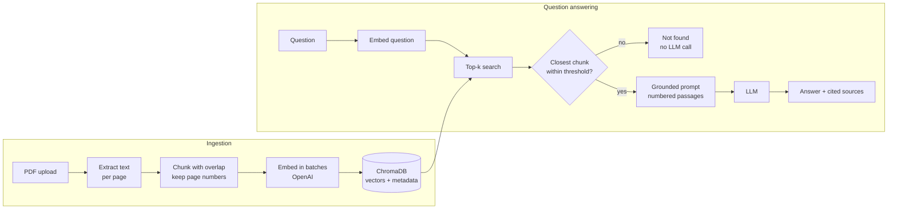

<div align="center">

# 📄 DocuRAG

**Ask questions about your PDFs and get answers grounded in the documents, with page-level citations.**

[](https://github.com/mohmadmansour54-ship-it/DocuRAG/actions/workflows/tests.yml)


</div>

---

DocuRAG is a **Retrieval-Augmented Generation (RAG)** REST API. You upload PDF documents, it splits them into overlapping chunks, embeds them, and stores the vectors in **ChromaDB**. When you ask a question, it retrieves the most relevant passages and has an LLM answer **only from those passages**, citing each one as `[1]`, `[2]`… with its file name and page number.

If the documents don't contain the answer, DocuRAG says so instead of making one up.

## ✨ Features

- **PDF ingestion**: page-by-page text extraction with whitespace normalisation
- **Overlapping chunking**: word-boundary sliding window that keeps the page number of every chunk
- **Semantic search**: OpenAI embeddings + ChromaDB with cosine distance
- **Cited answers**: every claim is tied to a source passage (file + page)
- **Two-layer hallucination guard**: a retrieval threshold *and* a grounded prompt
- **Duplicate-safe uploads**: content-hash document IDs, so re-uploading a file costs nothing
- **Fully tested offline**: 33 pytest tests with fake models, no API key needed in CI
- **Docker-ready** with a persistent volume for the vector store

## 🏗️ Architecture



## 🧠 Engineering decisions

| Decision | Why |
| --- | --- |
| **Chunks of ~800 chars with 150 chars overlap** | One chunk holds roughly a paragraph. The overlap means a sentence split at a chunk boundary is still complete in one of the two chunks, so retrieval doesn't miss it. |
| **Chunk per page, store page in metadata** | Lets every answer cite the exact page, which makes answers verifiable. |
| **Retrieval threshold (`MAX_DISTANCE`) before the LLM** | If even the best match is far from the question, the documents don't cover it. Refusing early prevents hallucinated answers and saves a model call. |
| **Grounded system prompt + fixed "not found" sentence** | A second guard for when retrieval finds something loosely related but not the answer. The fixed sentence is detected in code and returned as `found: false`. |
| **Parse `[n]` citations from the answer** | Only the passages the model actually used are returned as sources, and invalid numbers are ignored. |
| **Content hash as document ID** | Uploading the same file twice is a no-op, so there are no duplicate vectors or repeated embedding costs. |
| **`Embedder` / `ChatModel` protocols** | The pipeline doesn't depend on OpenAI directly, so tests run with deterministic fakes and the provider can be swapped. |
| **`temperature=0`** | Factual Q&A should be deterministic and repeatable. |

## 🚀 Quick start

### Run locally

```bash
git clone https://github.com/mohmadmansour54-ship-it/DocuRAG.git
cd DocuRAG
python -m venv .venv && source .venv/bin/activate   # Windows: .venv\Scripts\activate
pip install -r requirements.txt
cp .env.example .env        # then put your OpenAI key in .env
uvicorn app.main:app --reload
```

Open **http://localhost:8000/docs** for the interactive Swagger UI.

### Run with Docker

```bash
docker build -t docurag .
docker run -p 8000:8000 --env-file .env -v docurag-data:/data docurag
```

## 📡 API

| Method | Endpoint | Description |
| --- | --- | --- |
| `POST` | `/documents` | Upload a PDF (multipart, field `file`) |
| `GET` | `/documents` | List indexed documents |
| `DELETE` | `/documents/{document_id}` | Remove a document and its vectors |
| `POST` | `/ask` | Ask a question: `{"question": "...", "top_k": 4}` |
| `GET` | `/health` | Health check |

**Upload a document**

```bash
curl -F "file=@manual.pdf" http://localhost:8000/documents
```

```json
{ "document_id": "3f9a1c2e8b7d4a60", "filename": "manual.pdf", "chunks": 12, "pages": 5, "already_indexed": false }
```

**Ask a question**

```bash
curl -X POST http://localhost:8000/ask \
  -H "Content-Type: application/json" \
  -d '{"question": "How long is the warranty?"}'
```

```json
{
  "answer": "The warranty lasts 24 months from the date of purchase [1]. It does not cover water damage [1].",
  "found": true,
  "sources": [
    { "citation": 1, "filename": "manual.pdf", "page": 2, "distance": 0.2141,
      "text": "Warranty The warranty lasts 24 months from the date of purchase. It does not cover water damage." }
  ]
}
```

**Out-of-scope question**

```json
{ "answer": "I couldn't find the answer to that in the uploaded documents.", "found": false, "sources": [] }
```

## ⚙️ Configuration

All settings are environment variables (see [`.env.example`](.env.example)):

| Variable | Default | Description |
| --- | --- | --- |
| `OPENAI_API_KEY` | – | Required |
| `CHAT_MODEL` | `gpt-4o-mini` | Model that writes the answer |
| `EMBEDDING_MODEL` | `text-embedding-3-small` | Embedding model |
| `CHUNK_SIZE` / `CHUNK_OVERLAP` | `800` / `150` | Chunking, in characters |
| `TOP_K` | `4` | Passages retrieved per question |
| `MAX_DISTANCE` | `0.75` | Cosine distance cut-off for "relevant" |
| `CHROMA_PATH` | `./chroma_data` | Where vectors are stored |

## 🧪 Tests

```bash
pip install -r requirements-dev.txt
pytest -v
```

The suite uses a deterministic bag-of-words **fake embedder**, a scripted **fake chat model**, and an in-memory ChromaDB, so it runs in under a second with no API key. It covers:

- chunk size limits, overlap, and no lost words
- PDF extraction, blank pages, scanned/corrupt files
- citations: parsing, out-of-range numbers, fallback when the model forgets to cite
- out-of-scope questions are refused **without calling the LLM**
- duplicate uploads are not re-embedded
- the full HTTP flow: upload → list → ask → delete, plus validation errors
- OpenAI adapters: request batching and response ordering (mocked client)

## 📁 Project structure

```
DocuRAG/
├── app/
│   ├── main.py          # FastAPI routes and dependency wiring
│   ├── rag.py           # ingestion + retrieval + answer pipeline
│   ├── chunking.py      # overlapping word-boundary chunker
│   ├── pdf_loader.py    # PDF → pages of clean text
│   ├── vector_store.py  # ChromaDB wrapper with citation metadata
│   ├── providers.py     # Embedder / ChatModel protocols + OpenAI implementations
│   ├── prompts.py       # grounded system prompt
│   ├── schemas.py       # Pydantic request/response models
│   └── config.py        # settings from environment
├── tests/               # 33 offline tests
├── Dockerfile
└── .github/workflows/tests.yml
```

## 🗺️ Roadmap

- [ ] Evaluation script: a set of question/answer pairs to measure answer accuracy
- [ ] Hybrid search (BM25 + vectors) for exact terms like product codes
- [ ] OCR for scanned PDFs
- [ ] Streaming answers
- [ ] Simple web UI

## 📝 License

[MIT](LICENSE) © Mohammad Mansour
